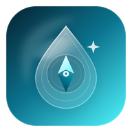

# Aqualux

<p>
  
</p>

Aqualux is a native **Android browser**. Pages render in Android System WebView, one WebView per tab. The chrome is Jetpack Compose and follows UI Isaiah's Liquid Glass tokens (`tokens.ts` / `aqualux-tokens.css`, v1.0.0): multi-stop translucent fills, a 1px specular highlight, concentric corners, and the same customization schema.

| | |
|---|---|
| Package name | `com.aqualux.browser` |
| Version | 1.0.1 (`versionCode` 2) |
| minSdk | 26 (Android 8.0) |
| targetSdk / compileSdk | 37 / 37.2 |

The icon above is the official launcher icon (Liquid Glass mark).

## Install the APK (sideload)

This build is **not** distributed on the Play Store. Download the signed release APK [`Aqualux-1.0.1.apk`](https://github.com/Woodjamesley201/Aqualux/releases/download/v1.0.1/Aqualux-1.0.1.apk) from [Release v1.0.1](https://github.com/Woodjamesley201/Aqualux/releases/tag/v1.0.1), then install it on the phone:

1. Download `Aqualux-1.0.1.apk` from [Release v1.0.1](https://github.com/Woodjamesley201/Aqualux/releases/tag/v1.0.1).
2. Enable **Install unknown apps** for the browser you used to download the file (Android Settings → Apps → that browser → Install unknown apps). This is a one-time step for that browser.
3. Open the downloaded APK and confirm the install.

The release APK is minified with R8 and signed. Android will not install an unsigned release APK. A later build signed with a different key cannot update this install; uninstall Aqualux first, or sign the update with the same sideload keystore (see [Signing](#signing)).

With a computer and USB debugging, the same APK can be installed with:

```bash
adb install -r Aqualux-1.0.1.apk
```

Aqualux registers `VIEW` intents for `http` and `https`, plus web search and shared text, so it can be chosen as the default browser in system settings.

The shelf floats over edge-to-edge page content. On a phone it sits under the status bar: a tab row, a toolbar, and a pill omnibox. Scroll down and it collapses to a centered host pill. Scroll up, or tap the pill, and it opens again.

## Architecture

```
MainActivity                edge-to-edge host, permissions, file chooser, fullscreen video
BrowserViewModel           tabs, WebView pool, session, history, bookmarks, settings
WebViewConfigurator        security policy applied to every WebView
OmniboxResolver            URL vs search, bare-host https, local/IP http
SessionSerializer          session JSON (order, scroll, pins) — unit tested
LiquidGlass                token math ported from the design handoff — unit tested
ui/theme/GlassTokens       Compose colors, blur radii, radii, and chrome metrics
```

Session, history, and bookmarks are JSON files in app storage. Settings use DataStore. Idle background tabs are destroyed after a configurable period; their URL, title, favicon, and scroll position stay, and the tab reloads when you return.

Web content never gets a JavaScript interface. File URL access is off, mixed content is never allowed, Safe Browsing is on, and certificate errors are cancelled. There is no "proceed anyway" path.

## Requirements

- JDK 17 or newer (the project compiles to Java 17; CI uses Temurin 21)
- Android SDK platform **37.2** (`platforms;android-37.2`) and build-tools 37
- `ANDROID_HOME` set, or `sdk.dir` in a gitignored `local.properties`

```bash
sdkmanager "platforms;android-37.2" "build-tools;37.0.0" "platform-tools"
```

`minSdk` is 26. `targetSdk` is 37. `compileSdk` is 37.2.

## Open and build (Gradle)

Open the repository root in Android Studio, or build from a terminal. The Gradle wrapper is `./gradlew` (Gradle 9.6). You need JDK 17 or newer and the Android SDK packages listed under [Requirements](#requirements).

```bash
./gradlew assembleDebug
./gradlew assembleRelease
./gradlew test
```

Outputs:

- `app/build/outputs/apk/debug/aqualux-debug.apk` — debug key, not minified
- `Aqualux-1.0.1.apk` — R8 minified release, signed with the v1.0.0 sideload keystore

`assembleRelease` is minified with R8 and resource shrinking. If `keystore.properties` and the `AQUALUX_*` environment variables are both absent, the release APK is signed with the debug keystore so it is still installable. A debug-signed release build cannot be updated later by a build signed with the sideload keystore without uninstalling first.

## Signing

Copy `keystore.properties.example` to `keystore.properties` (gitignored):

```properties
storeFile=/absolute/or/repo-relative/aqualux-release.keystore
storePassword=…
keyAlias=aqualux
keyPassword=…
```

Or export:

| Variable | Meaning |
|---|---|
| `AQUALUX_STORE_FILE` | Path to the `.keystore` / `.jks` |
| `AQUALUX_STORE_PASSWORD` | Store password |
| `AQUALUX_KEY_ALIAS` | Key alias |
| `AQUALUX_KEY_PASSWORD` | Key password |

File values win over environment variables when both are set. Generate a keystore with:

```bash
keytool -genkeypair -v -keystore aqualux-release.keystore -alias aqualux \
  -keyalg RSA -keysize 2048 -validity 10000
```

The v1.0.0 APK on GitHub Releases was signed with a dedicated **sideload** keystore (alias `aqualux`, RSA 2048). It is an install key for this sideload build, not a Play App Signing / upload key for production. `keystore.properties` and `*.keystore` are gitignored, so the private key is not in this repository. Keep a copy of that keystore if you want a later APK to update the installed app in place.

GitHub Actions (`.github/workflows/android.yml`) builds both APKs on every push and pull request and uploads them as artifacts. On a tag `v*`, it attaches those APKs to the GitHub Release. To sign that release with the sideload key, set repository secrets `AQUALUX_KEYSTORE_BASE64`, `AQUALUX_STORE_PASSWORD`, `AQUALUX_KEY_ALIAS`, and `AQUALUX_KEY_PASSWORD`.

## Tests

```bash
./gradlew test
```

Unit tests cover omnibox resolution (including blocked `javascript:`, `file:`, and `data:` URLs), suggestion ranking, session JSON round-trips, the SSL/DNS/connection taxonomy, download filenames, the desktop user-agent rewrite, and the Liquid Glass token math (fill strength, concentric radii, chrome heights, blur).

## Design tokens

`app/src/main/java/com/aqualux/browser/design/LiquidGlass.kt` is the numeric port of Isaiah's token files. `GlassTokens.resolve` turns those numbers into Compose colors. Retune appearance there.

Settings → Appearance exposes the customization schema: theme, accent hue (Lagoon 199 and the seven other swatches), glass intensity (frosted → clear), blur scale, corner style (round / soft / square), density (regular / compact), refraction, reduce effects, and the blur toggle. Reduce-motion also follows the system animator duration scale.

Blur uses `RenderEffect` on Android 12 (API 31) and later. Older devices, reduced effects, and the blur toggle use the translucent fills only. WebView pages are composited in their own surface, so the frost is the glass material itself rather than a live sample of the page.

## Stack

Kotlin, Jetpack Compose, Android Gradle Plugin 9.5 with built-in Kotlin, Gradle 9.6, version catalog in `gradle/libs.versions.toml`.
